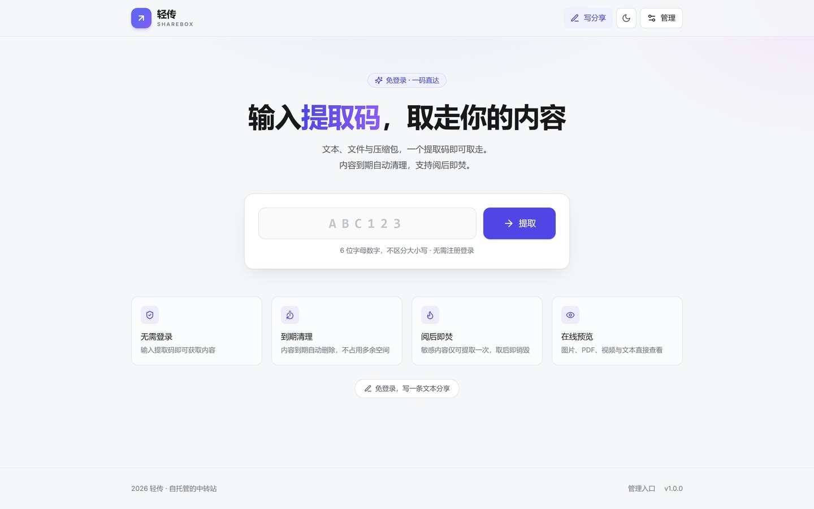
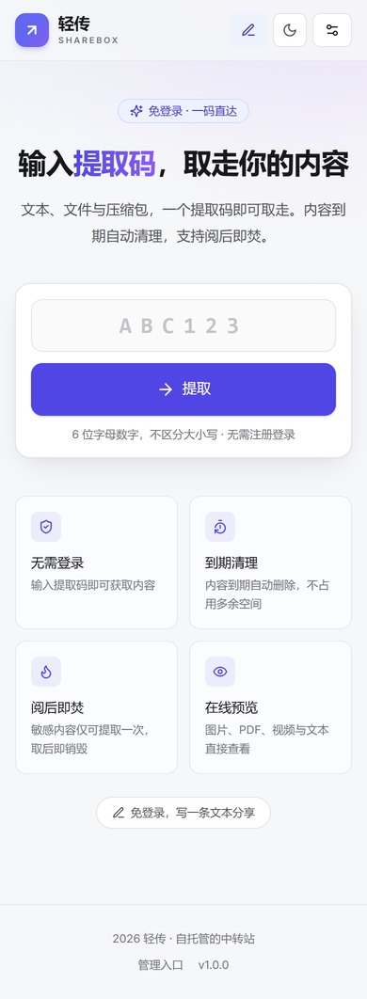
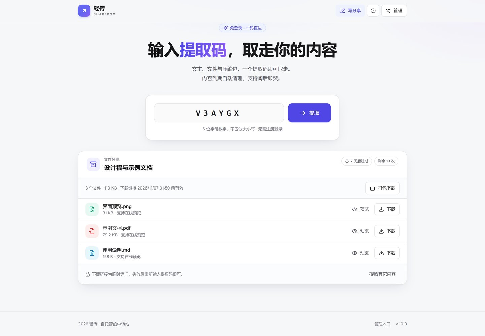
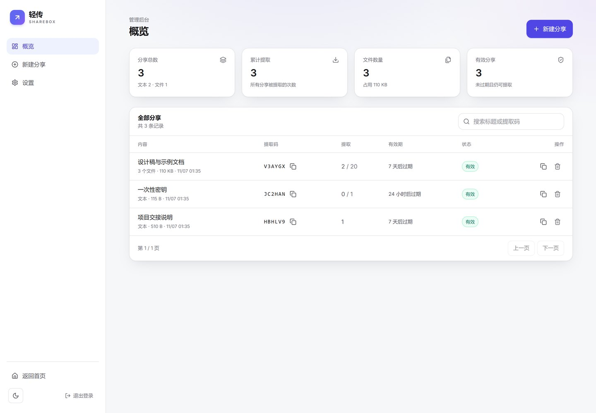
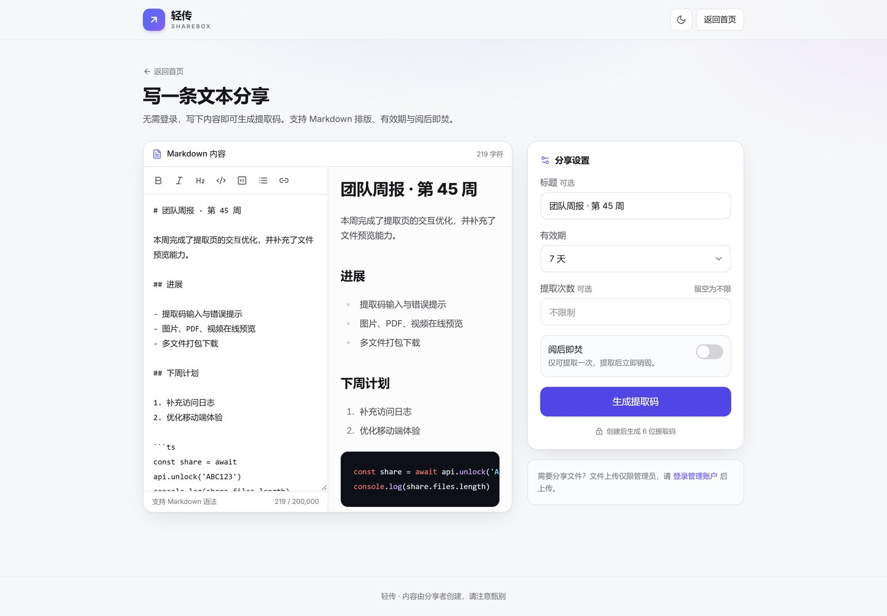
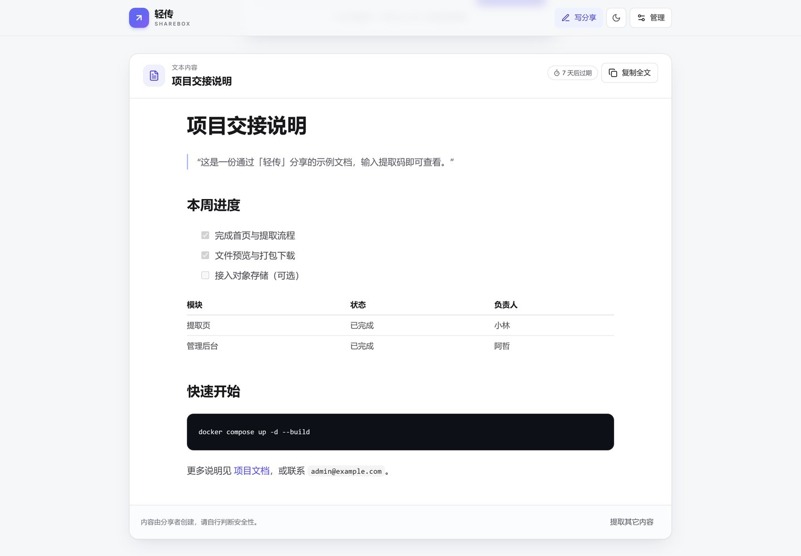

# 轻传 ShareBox

> 用 6 位提取码传递文本与文件的自托管中转站。无需注册，输入提取码即可取走；到期自动清理，也可以阅后即焚。

适配 PC、平板与手机，支持浅色 / 深色模式。前后端打包为单个 Docker 镜像，数据保存在 SQLite 与本地磁盘，适合部署在 Debian 13 ARM64 等小型服务器上。

## 界面预览

<p align="center">
  
  
</p>

<p align="center">
  
  
</p>

<p align="center">
  
  
</p>

## 功能

**访客（无需登录）**

- 输入 6 位提取码，获取文本或文件
- 图片、PDF、视频、音频、纯文本在线预览
- 图片 / PDF / 视频等支持 Range 分段加载
- 多文件分享支持逐个下载或打包 ZIP
- 免登录创建文本分享：Markdown 实时预览、代码高亮、标题、有效期、提取次数、阅后即焚
- 扫码打开分享链接，提取码自动填入
- 响应式布局与深色模式

**管理员（登录后）**

- 上传文件（多文件、拖拽、上传进度、大小校验）
- 创建文本或文件分享，设置有效期与提取次数
- 管理后台：搜索、查看提取码、复制分享链接、删除分享、统计占用空间
- 修改管理员密码、退出所有设备

**安全与运维**

- 提取码与登录接口限流，防暴力猜测
- 管理员密码使用 scrypt 哈希；登录会话存于数据库
- 短时 HMAC 下载令牌（默认 60 分钟）
- HTML / SVG / 脚本等类型强制下载，预览仅放行白名单 MIME
- CSP、`X-Content-Type-Options`、同源校验、HttpOnly Cookie
- 到期分享与残留临时文件自动清理

## 技术栈

| 层 | 选型 |
| --- | --- |
| 前端 | React 18、React Router 6、Vite 7、Tailwind CSS 3、marked + highlight.js + DOMPurify |
| 后端 | Node.js 24、Fastify 5、`node:sqlite`（内置 SQLite，无原生依赖） |
| 部署 | Docker 多阶段构建、Docker Compose、单容器 + 数据卷 |

镜像内不依赖 glibc 之外的本地库，`node:24-bookworm-slim` 原生支持 `linux/arm64`，在 Debian 13 ARM64 上直接构建即可，无需交叉编译。

## 快速部署（Debian 13 ARM64）

### 1. 安装 Docker Engine 与 Compose

按 Docker 官方文档安装（推荐）：

```bash
sudo apt-get update
sudo apt-get install -y ca-certificates curl
sudo install -m 0755 -d /etc/apt/keyrings
sudo curl -fsSL https://download.docker.com/linux/debian/gpg -o /etc/apt/keyrings/docker.asc
sudo chmod a+r /etc/apt/keyrings/docker.asc

echo "deb [arch=$(dpkg --print-architecture) signed-by=/etc/apt/keyrings/docker.asc] \
https://download.docker.com/linux/debian $(. /etc/os-release && echo "$VERSION_CODENAME") stable" \
  | sudo tee /etc/apt/sources.list.d/docker.list > /dev/null

sudo apt-get update
sudo apt-get install -y docker-ce docker-ce-cli containerd.io docker-buildx-plugin docker-compose-plugin
sudo systemctl enable --now docker
```

确认版本：

```bash
docker version
docker compose version
```

### 2. 获取代码并配置

```bash
git clone <你的仓库地址> sharebox
cd sharebox

cp .env.example .env
```

编辑 `.env`，**至少修改 `ADMIN_PASSWORD`（不少于 8 位）**。`.env` 已被 `.gitignore` 忽略，请勿提交；建议同时执行 `chmod 600 .env`。

也可以生成一个随机密码：

```bash
sed -i "s|^ADMIN_PASSWORD=.*|ADMIN_PASSWORD=$(openssl rand -base64 18)|" .env
cat .env | grep ADMIN_PASSWORD
```

### 3. 构建并启动

```bash
docker compose up -d --build
docker compose ps
docker compose logs -f sharebox
```

首次构建会安装依赖并编译前后端，通常需要 2–5 分钟。构建在服务器本机完成，自动匹配 arm64 架构。

浏览器访问：

```
http://<服务器 IP>:8080
```

如启用了防火墙，请放行对应端口（默认 8080）。

### 4. 更新

```bash
git pull
docker compose up -d --build
```

`/data` 卷中的数据不会丢失。

## 使用方式

### 访客提取

1. 打开首页，输入 6 位提取码（不区分大小写）。
2. 文本会直接展开；文件会列出名称、大小与预览 / 下载按钮。
3. 文件分享的下载链接是临时凭证，默认 60 分钟内有效；失效后重新输入提取码即可。

### 免登录写文本

顶部「写分享」或首页底部入口进入 `/write`：

- 支持 Markdown 与代码块高亮
- 可设置标题、有效期、提取次数、阅后即焚
- 创建后展示提取码、分享链接与二维码

公开创建按 IP 限流（默认 6 次 / 10 分钟），请勿用于大规模公开内容托管。

### 管理员上传文件

1. 访问 `/admin`，输入 `.env` 中的初始密码。
2. 「新建分享」→「文件」，拖拽或选择文件。
3. 设置有效期与提取次数后创建。
4. 在概览中随时复制提取码或分享链接。

分享链接形如 `https://your-domain/#c=ABC123`，二维码内容与此相同。提取码放在 URL 的 `#` 片段中，不会发送到服务器日志。

## 配置项

| 变量 | 默认值 | 说明 |
| --- | --- | --- |
| `ADMIN_PASSWORD` | 必填 | 管理员初始密码，至少 8 位。仅首次启动时写入数据库 |
| `SITE_NAME` | `轻传` | 页面左上角站点名称 |
| `SHAREBOX_PORT` | `8080` | 宿主机映射端口，容器内固定 3000 |
| `MAX_UPLOAD_MB` | `200` | 单文件大小上限（MB） |
| `MAX_TOTAL_MB` | `500` | 单次分享所有文件总大小上限（MB） |
| `DOWNLOAD_TOKEN_MINUTES` | `60` | 下载令牌有效期（分钟） |
| `TRUST_PROXY` | `false` | 在 Nginx / Caddy 后设为 `true`，以读取真实 IP 与协议 |
| `COOKIE_SECURE` | `auto` | `auto` / `true` / `false`；HTTPS 环境建议 `true` |
| `LOG_LEVEL` | `info` | `debug` / `info` / `warn` / `error` |
| `TZ` | `Asia/Shanghai` | 容器时区 |

修改配置后执行：

```bash
docker compose up -d
```

### 数据与备份

容器内数据目录：

```
/data
├── sharebox.db        # SQLite 数据库（分享、会话、设置）
├── sharebox.db-wal
├── uploads/<shareId>/ # 上传的文件
└── tmp/               # 上传临时文件
```

对应 Compose 命名卷 `sharebox_data`。

一致性备份建议先停止容器：

```bash
docker compose stop sharebox
docker run --rm -v sharebox_data:/data -v "$PWD":/backup alpine \
  tar czf /backup/sharebox-$(date +%F-%H%M).tar.gz -C /data .
docker compose start sharebox
```

恢复：

```bash
docker compose stop sharebox
docker run --rm -v sharebox_data:/data -v "$PWD":/backup alpine \
  sh -c "rm -rf /data/* && tar xzf /backup/sharebox-YYYY-MM-DD-HHMM.tar.gz -C /data"
docker compose start sharebox
```

也可以直接把 `docker-compose.yml` 中的 `sharebox_data` 换成宿主机目录，例如 `./data:/data`，便于用 restic / rsync 备份。此时请确保目录对容器内 `node` 用户（UID 1000）可写：

```bash
mkdir -p data && sudo chown -R 1000:1000 data
```

### 反向代理与 HTTPS

把域名解析到服务器后，可以用 Caddy 自动申请证书：

```caddyfile
share.example.com {
    encode zstd gzip
    reverse_proxy 127.0.0.1:8080
}
```

然后在 `.env` 中设置：

```dotenv
TRUST_PROXY=true
COOKIE_SECURE=true
```

重启：

```bash
docker compose up -d
```

Nginx 示例：

```nginx
server {
    listen 443 ssl http2;
    server_name share.example.com;

    # TLS 证书配置略

    client_max_body_size 600m;       # 需大于 MAX_TOTAL_MB
    proxy_request_buffering off;     # 大文件上传建议关闭缓冲

    location / {
        proxy_pass http://127.0.0.1:8080;
        proxy_http_version 1.1;
        proxy_set_header Host $host;
        proxy_set_header X-Real-IP $remote_addr;
        proxy_set_header X-Forwarded-For $proxy_add_x_forwarded_for;
        proxy_set_header X-Forwarded-Proto $scheme;
    }
}
```

启用 HTTPS 后建议把 `COOKIE_SECURE` 设为 `true`，防止 Cookie 在 HTTP 下传输。

## 忘记管理员密码

在 `.env` 中临时增加（或修改）：

```dotenv
ADMIN_PASSWORD=新的至少8位密码
RESET_ADMIN_PASSWORD=true
```

重启一次：

```bash
docker compose up -d
```

随后**务必删除 `RESET_ADMIN_PASSWORD` 并再次 `docker compose up -d`**，否则每次启动都会重置密码。重置会清空所有登录会话。

## 本地开发

要求 Node.js ≥ 24（推荐使用 Docker 镜像中的版本）与 pnpm 11：

```bash
pnpm install
cp .env.example .env         # 修改 ADMIN_PASSWORD
pnpm dev
```

- 前端：<http://localhost:5173>（Vite，自动代理 `/api`）
- 后端：<http://localhost:3000>
- 数据默认写入 `./data`，可用 `DATA_DIR` 修改

生产模式本地运行：

```bash
pnpm build
NODE_ENV=production STATIC_DIR=./dist pnpm start
```

### 类型检查与接口测试

```bash
pnpm typecheck
```

启动一个测试服务后运行端到端冒烟测试：

```bash
# 终端 1
ADMIN_PASSWORD=test123456 DATA_DIR=./.data LOG_LEVEL=warn pnpm dev:server

# 终端 2
ADMIN_PASSWORD=test123456 pnpm test:api
```

测试覆盖登录、文本 / 文件分享、提取、预览响应头、ZIP、删除、改密、限流等 30 项检查。

## API 一览

| 方法 | 路径 | 鉴权 | 说明 |
| --- | --- | --- | --- |
| `GET` | `/api/health` | 否 | 健康检查 |
| `GET` | `/api/config` | 否 | 站点配置（名称、大小限制等） |
| `POST` | `/api/unlock` | 否 | 用提取码换取内容或下载令牌 |
| `POST` | `/api/shares/text` | 否 | 免登录创建文本分享（限流） |
| `GET` | `/api/files/:id?token=` | 令牌 | 下载 / 预览文件 |
| `GET` | `/api/shares/:id/zip?token=` | 令牌 | 打包下载 |
| `POST` | `/api/admin/login` | 否 | 管理员登录 |
| `POST` | `/api/admin/logout` | 否 | 退出当前会话 |
| `GET` | `/api/admin/me` | 管理员 | 会话校验 |
| `GET` | `/api/admin/stats` | 管理员 | 统计信息 |
| `GET` | `/api/admin/shares` | 管理员 | 分享列表（搜索、分页） |
| `POST` | `/api/admin/shares` | 管理员 | 创建文本分享 |
| `POST` | `/api/admin/shares/files` | 管理员 | 上传文件并创建分享 |
| `DELETE` | `/api/admin/shares/:id` | 管理员 | 删除分享与文件 |
| `POST` | `/api/admin/password` | 管理员 | 修改密码 |
| `POST` | `/api/admin/logout-all` | 管理员 | 退出所有设备 |

错误响应统一为：

```json
{ "error": "not_found", "message": "提取码不存在，请检查后重试" }
```

## 安全说明

- 提取码为 6 位、去除易混淆字符的字母数字组合（约 10.7 亿种），接口按 IP 限流（提取 20 次/分钟，登录 8 次/分钟）。
- 提取码以明文保存在 SQLite 中，便于管理员在后台再次复制；数据库与 `/data` 是信任边界，请限制服务器访问权限。
- 下载令牌使用 HMAC-SHA256 签名并绑定分享 ID，默认 60 分钟有效，可通过 `DOWNLOAD_TOKEN_MINUTES` 调整。
- 上传文件以随机 ID 落盘，原始文件名仅存数据库；打包 ZIP 时重新清洗文件名，避免路径穿越。
- 预览只放行图片、PDF、音视频与纯文本等白名单类型；HTML、SVG、XML、脚本等一律作为附件下载，避免同源 XSS。
- 管理员接口校验同源 `Origin`，会话 Cookie 为 `HttpOnly` + `SameSite=Lax`。
- 本工具不做病毒扫描。请只让可信的人上传文件；公网部署建议配合 HTTPS、防火墙与定期备份。
- 文本分享内容会按 Markdown 渲染并经过 DOMPurify 清洗；但分享者仍可插入链接或图片，请自行甄别内容。

## 项目结构

```
.
├── server/                # Fastify 后端（TypeScript）
│   ├── routes/            # public / admin 路由
│   ├── index.ts           # 启动、插件、静态资源
│   ├── store.ts           # SQLite 初始化与设置
│   ├── shares.ts          # 分享与提取逻辑
│   ├── auth.ts            # 管理员会话
│   └── cleanup.ts         # 过期清理
├── src/                   # React 前端
│   ├── pages/             # 首页、写文本、后台
│   ├── components/        # 设计系统与业务组件
│   └── lib/               # API、Markdown、主题、格式化
├── public/                # 静态资源
├── scripts/smoke-test.mjs # API 冒烟测试
├── Dockerfile
├── docker-compose.yml
└── .env.example
```

## 常见问题

**上传返回 413**

同时检查三处限制：`.env` 的 `MAX_UPLOAD_MB` / `MAX_TOTAL_MB`、反向代理的请求体上限（如 Nginx `client_max_body_size`）、以及代理是否开启缓冲。

**提取时返回 429**

触发了限流。等待一分钟再试；如果多人共用出口 IP，可适当调高 `server/routes/public.ts` 中 `/api/unlock` 的 `max` 值后重新构建。

**时间显示不正确**

设置 `TZ=Asia/Shanghai` 并重启；数据库存的是时间戳，展示使用浏览器本地时区。

**能改站点名称 / 上传大小限制吗？**

可以，修改 `.env` 后 `docker compose up -d`。`SITE_NAME` 会立即生效；大小限制在下次上传时生效。

**支持多个管理员或对象存储吗？**

当前版本为单管理员、本地磁盘存储，保持部署简单。多用户 / S3 需要额外改造。

## License

MIT
